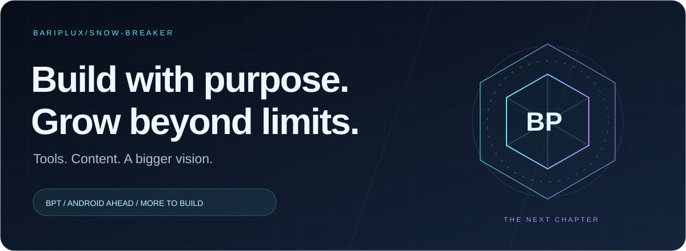
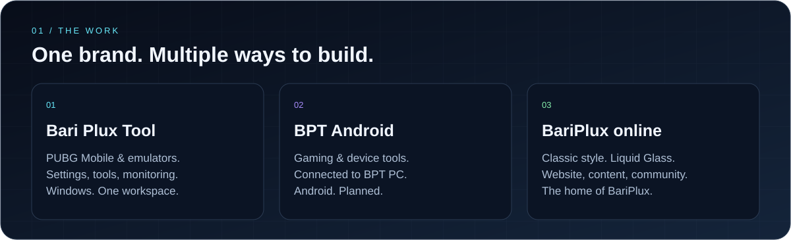
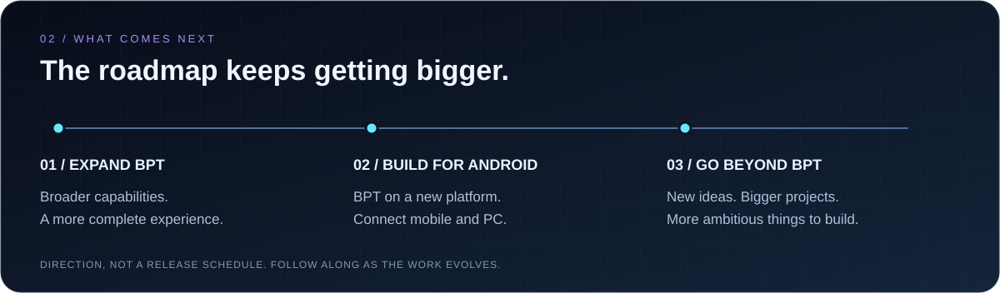

  

  <a href="https://bariplux.com">Website</a> &nbsp; / &nbsp;
  <a href="#the-work">The work</a> &nbsp; / &nbsp;
  <a href="#whats-next">What's next</a> &nbsp; / &nbsp;
  <a href="#find-me-online">Find me online</a>

 

I'm **BariPlux**, also known as **Snow-Breaker** — the person behind **Bari Plux Tool (BPT)**. I'm building tools, creating content, and growing a community around the work.

BPT is a starting point for a bigger vision: expand the project, bring it to Android, and build new, more ambitious projects beyond it. This profile is where that journey comes together.

 

## The work

### BPT 3 · PC

A Windows toolkit for **PUBG Mobile players and emulator users** — bringing graphics settings, performance tools, file management, and everyday utilities into one place.

| Area | What it brings together |
| :--- | :--- |
| **Graphics & controls** | FPS and graphics presets, visual styles, custom views and resolutions, keymapping, and saved profiles. |
| **Performance & monitoring** | Match Prep, optimization tools, Game Mode, smart settings, and an **in-game performance overlay**. |
| **Files & recovery** | File management, APK / XAPK / OBB installation, backups and restore, and **Installed Files for emulators**. |
| **Emulators & connectivity** | Tools for GameLoop and other supported emulators, connection diagnostics, and network utilities. |
| **Account & community** | Cloud backup, Pro options, community chat, announcements, bug reporting, and support. |
| **Everyday experience** | A home dashboard, themes, **27 languages**, system information, and in-app updates. |

Feature availability varies by emulator, hardware, and plan. Preset FPS targets depend on game and device support.

**[Explore BPT on the website →](https://bariplux.com)**

 

### BariPlux.com · The home of the ecosystem

The website brings together the projects, updates, content, and community. Its latest refresh returns to the **classic BariPlux style and background**, paired with **Liquid Glass cards** and a focus on performance, optimization, and web standards.

**[Visit the website →](https://bariplux.com)** &nbsp; · &nbsp; **[Watch on YouTube →](https://www.youtube.com/@BariPlux)**

 

## What's next

### BPT Android · Planned

A mobile companion with its own Android-focused tools — designed around gaming, device insight, file management, and a connected BPT experience.

| Planned focus | Direction |
| :--- | :--- |
| **Gaming & performance** | Game Mode, smart game settings, game profiles, launch shortcuts, quick actions, and device-aware optimization. |
| **Device insight** | A gaming dashboard, system health, memory and battery monitoring, and FPS and temperature monitoring where supported. |
| **Network tools** | DNS testing and configuration, ping, packet loss, and Wi-Fi diagnostics. |
| **Files & apps** | Accessible-storage file management, archives, app installation, storage analysis, and backup and restore. |
| **A shared experience** | Sign-in, Pro and trial options, cloud synchronization, chat, announcements, support, themes, and languages. |
| **PC ↔ mobile** | Connect the two apps, with planned remote PC / GameLoop management through a companion PC agent. |

Android features are planned; availability will depend on device support, permissions, and platform restrictions. Some advanced optimizations will require root.

### Beyond one app

- **Keep expanding BPT PC:** broader capabilities and a more complete experience.
- **Connect desktop and mobile:** build a coherent ecosystem across both platforms.
- **Keep improving the website:** evolve the classic visual identity, Liquid Glass presentation, and performance.
- **Create beyond BPT:** pursue new, larger, independent projects as the vision grows.

This is our direction, with no release dates announced yet. Follow the community channels for progress and announcements.

 

### Learning stack

  
  
  
  
  
  

 

## Find me online

  
  
  
  
  
  
  
  
  
  

Project updates, videos, community, and support — all in one place. 
<a href="mailto:Support@BariPlux.com">Support@BariPlux.com</a> · <a href="https://ko-fi.com/BariPlux">Support the work on Ko-fi</a>

 

---

BARIPLUX / SNOW-BREAKER · BUILD WITH PURPOSE. GROW BEYOND LIMITS.

