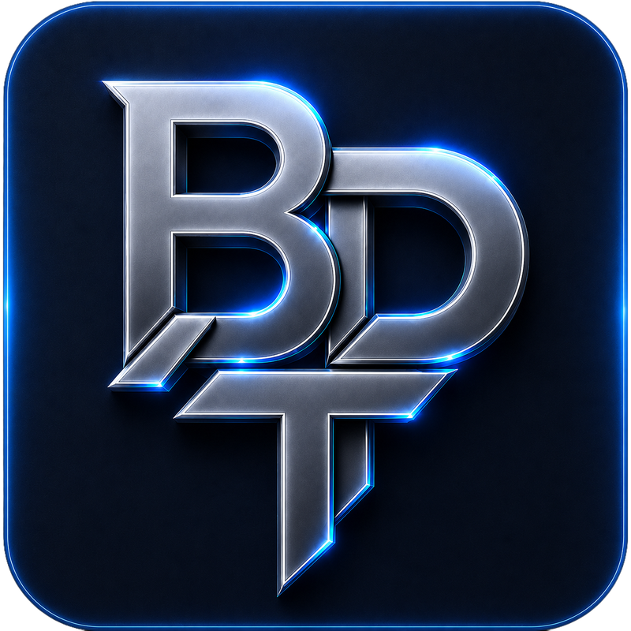

# BariPlux

**Independent software creator · Windows, Android & Web**

I'm **Snow-Breaker**, the creator behind **Bari Plux Tool**. I build software for people who want more control over their gaming setup — and work across the applications, website, and services that support it.

My work spans product design, desktop development, Android development, and the web. I care about how those pieces fit together: a useful feature needs a clear interface, reliable behavior, and a way for people to get help when something goes wrong.

**Currently focused on:** improving BPT for Windows, developing BPT Android, and connecting both experiences.

---

## Selected work

### Bari Plux Tool

A growing software family for **PUBG Mobile players and emulator users**.

**Windows · BPT 3**

A desktop toolkit that brings graphics and FPS settings, control profiles, performance tools, emulator utilities, file management, and backups into one application. Recent additions include an **in-game performance overlay** and **Installed Files for emulators**.

I work on the experience around those tools too: account flows, cloud backup, community chat, diagnostics, themes, updates, and localization across **27 languages**, including right-to-left interfaces.

**Android · In development**

An Android application with gaming tools, device and network diagnostics, file management, and shared account features. The goal is a connected PC and mobile experience, including planned remote PC / GameLoop management. Features will depend on device support and permissions; a release date has not been announced.

### BariPlux.com

The home for the software, product updates, guides, videos, and community. My work covers interface design, frontend development, product and account pages, and performance improvements.

The latest refresh brings back the classic BariPlux visual identity with **Liquid Glass cards**, alongside continued optimization and work on web standards.

[Visit BariPlux.com →](https://bariplux.com)

## Engineering & craft

| Platform | Technologies I work with |
| :--- | :--- |
| **Windows** | C# · .NET · WinUI 3 · XAML |
| **Android** | Kotlin · Java · Jetpack Compose · Material 3 |
| **Web** | HTML · CSS · JavaScript |
| **Delivery** | Git · automated tests · build and release workflows |

Across these projects, I spend time on the work that makes software easier to maintain and use:

- **Interfaces that explain themselves:** clear navigation, meaningful settings, and language support that includes RTL layouts.
- **Changes people can recover from:** backup and restore, useful diagnostics, and clear feedback when a device or platform limits a feature.
- **Iteration grounded in use:** community feedback and bug reports, supported by tests, documentation, and hands-on verification.

I'm continuing to deepen my skills in application architecture, Android development, and the connections between desktop, mobile, and web services.

## What's ahead

BPT is my main focus today. The longer-term ambition is to turn the experience gained here into **new, larger projects beyond BPT** — while continuing to improve the products and community already taking shape.

## Connect

**Content** &nbsp; [YouTube](https://www.youtube.com/@BariPlux) · [TikTok](https://www.tiktok.com/@BariPlux) · [Instagram](https://www.instagram.com/BariPlux)

**Community** &nbsp; [Discord](https://discord.com/invite/fQkyq8VR59) · [Telegram](https://t.me/BariPlux) · [X](https://x.com/BariPlux)

**Contact** &nbsp; [Support@BariPlux.com](mailto:Support@BariPlux.com) 
**Support the work** &nbsp; [Ko-fi](https://ko-fi.com/BariPlux)
