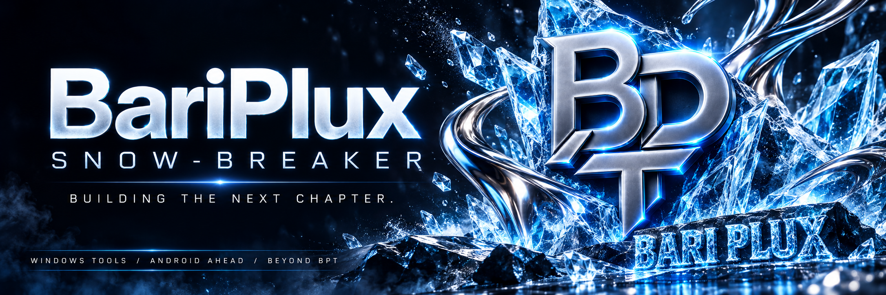
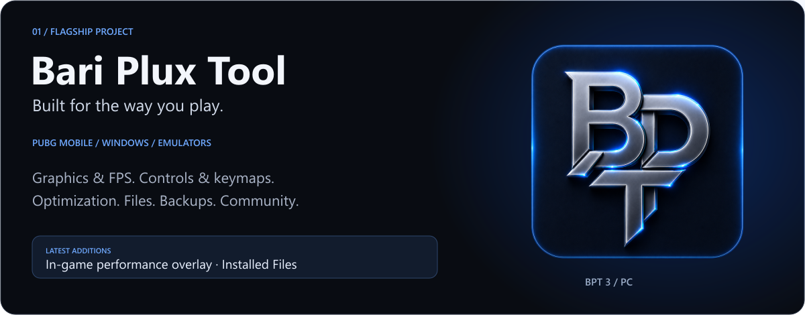
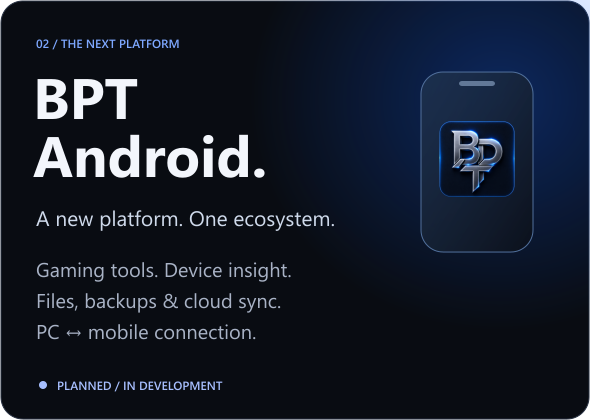
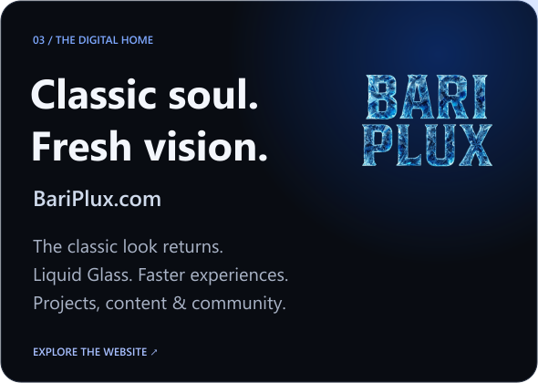
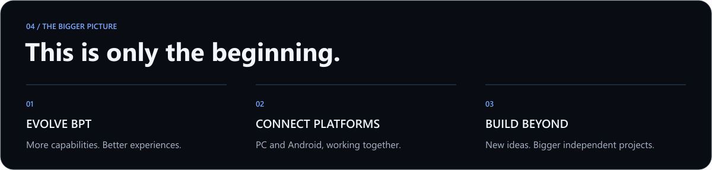

  

  <a href="https://bariplux.com"><b>EXPLORE BARIPLUX ↗</b></a> &nbsp; · &nbsp;
  <a href="#the-ecosystem">THE ECOSYSTEM</a> &nbsp; · &nbsp;
  <a href="#the-next-chapter">THE NEXT CHAPTER</a> &nbsp; · &nbsp;
  <a href="#stay-connected">CONNECT</a>

 

  <b>I'm BariPlux — known here as Snow-Breaker.</b> 
  The creator behind Bari Plux Tool. Building software, sharing what I learn, 
  and bringing a bigger vision to life — one project at a time.

 

## The ecosystem

  
  

**BPT 3** brings graphics settings, performance tools, emulator utilities, and everyday workflows into one Windows toolkit. **BariPlux.com** is the home for the software, updates, videos, and community — recently refreshed with the classic background and Liquid Glass cards.

<b>Inside BPT PC — explore the capabilities</b>

| Area | What it brings together |
| :--- | :--- |
| **Graphics & controls** | FPS and graphics presets, visual styles, custom views and resolutions, keymapping, and saved profiles. |
| **Performance & monitoring** | Match Prep, optimization tools, Game Mode, smart settings, and an **in-game performance overlay**. |
| **Files & recovery** | File management, APK / XAPK / OBB installation, backups and restore, and **Installed Files for emulators**. |
| **Emulators & connectivity** | Tools for GameLoop and other supported emulators, connection diagnostics, and network utilities. |
| **Account & community** | Cloud backup, Pro options, community chat, announcements, bug reporting, and support. |
| **Everyday experience** | A home dashboard, themes, **27 languages**, system information, and in-app updates. |

Feature availability varies by emulator, hardware, and plan. Preset FPS targets depend on game and device support.

 

## The next chapter

**BPT Android is planned as more than a companion.** We're working toward a mobile experience with gaming tools, device and network insight, file management, backups, and shared account and community features.

The bigger goal: **PC and mobile that work together**, including planned remote PC / GameLoop management through a companion PC agent. Beyond BPT, the ambition is to build new, larger projects with their own identities.

<b>BPT Android — explore the planned experience</b>

| Planned focus | Direction |
| :--- | :--- |
| **Gaming & performance** | Game Mode, smart game settings, game profiles, launch shortcuts, quick actions, and device-aware optimization. |
| **Device insight** | A gaming dashboard, system health, memory and battery monitoring, and FPS and temperature monitoring where supported. |
| **Network tools** | DNS testing and configuration, ping, packet loss, and Wi-Fi diagnostics. |
| **Files & apps** | Accessible-storage file management, archives, app installation, storage analysis, and backup and restore. |
| **A shared experience** | Sign-in, Pro and trial options, cloud synchronization, chat, announcements, support, themes, and languages. |
| **PC ↔ mobile** | Connect the two apps, with planned remote PC / GameLoop management through a companion PC agent. |

Android features are planned; availability will depend on device support, permissions, and platform restrictions. Some advanced optimizations will require root.

Roadmap items describe our direction. Release dates have not been announced.

 

## Stay connected

  
  
  
   
  
  
  
   
  
  
  
   

  <a href="https://www.youtube.com/@BariPlux">Watch the content</a> &nbsp; · &nbsp;
  <a href="https://discord.com/invite/fQkyq8VR59">Join the community</a> &nbsp; · &nbsp;
  <a href="https://ko-fi.com/BariPlux">Support the next chapter</a> 
  <a href="mailto:Support@BariPlux.com">Support@BariPlux.com</a> &nbsp; / &nbsp;
  <a href="https://guns.lol/BariPlux">All links</a>

 

<b>What I'm learning & building with</b>

HTML · CSS · Java · C# · C++ · .NET

Learning through real projects, experiments, and continuous iteration.

 

BARIPLUX / SNOW-BREAKER BUILDING THE NEXT CHAPTER.

